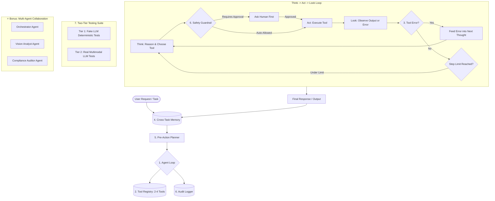

# PRD: Vision & Multimodal Workflow Automation Agent

**Document:** Product Requirements Document (PRD)  
**Version:** 1.0 (Course & Production Aligned)  
**Status:** Approved for Implementation  
**Runtime Constraint:** Pure Python 3.10+ (No LangChain, LlamaIndex, CrewAI, or high-level agent frameworks)

---

## 1. Overview & Executive Summary

The **Vision & Multimodal Workflow Automation Agent** is an autonomous AI agent that ingests unstructured multimodal inputs (invoices, receipts, damage photos, scanned documents, screen captures) and converts them into validated structured data, decisions, and system actions.

Unlike brittle traditional OCR or rigid automation templates, this agent dynamically reasons about visual content, formulates an explicit plan, invokes specialized tools, handles unexpected tool failures gracefully, remembers context across tasks, and respects strict human safety guardrails.

---

## 2. Target Users & Problem Statement

### Target Users
- **Operations & AP Leads:** Need to automate document and photo validation without losing auditability or straight-through accuracy.
- **Analysts & Reviewers:** Need an assistant that extracts data, checks rules, flags anomalies, and only escalates edge cases for human sign-off.
- **Software & Systems Engineers:** Need an embeddable, transparent agent loop written in clean, explainable plain Python with zero black-box framework lock-in.

### Problem Statement
- **Visual ambiguity:** Real-world documents are noisy, skewed, handwritten, or multi-page.
- **Fragile automation:** Scripted scrapers fail whenever formats change.
- **Lack of safety & control:** Autonomous agents can loop infinitely or perform unauthorized external mutations without human confirmation.
- **Framework bloat:** Heavy frameworks (LangChain, etc.) obscure the execution loop, make error debugging difficult, and add unnecessary abstraction layers.

---

## 3. The 7 Core Agent Requirements (+ Bonus)

The agent architecture is strictly built on the following 7 foundational parts, plus a multi-agent team bonus:



---

### 1️⃣ Part 1: The Loop (Think → Act → Look) `[L1, L3]`
- **Pattern:** ReAct (Reasoning + Acting) implemented in pure Python without third-party agent libraries.
- **Phases:**
  1. **Think:** The agent examines the original goal, the execution plan, past observations, and the conversation history to decide what to do next. It outputs a reasoning trace and selects an action.
  2. **Act:** The agent outputs a structured tool invocation: `tool_name` and `tool_arguments`.
  3. **Look:** The system invokes the chosen tool, captures the output (or failure message), and returns it as an `Observation` to the agent.
- **Termination:** The loop repeats until the agent outputs a final answer marker (e.g., `Final Answer: ...`) or hits a safety limit.

---

### 2️⃣ Part 2: 2–4 Tools, Clearly Described `[L2]`
The agent has access to exactly 4 focused, clearly documented tools. Each tool defines:
- A descriptive docstring with purpose and usage instructions.
- Strict input parameter types and schema.
- Structured return format (JSON/dictionary).

| # | Tool Name | Description | Inputs | Outputs |
|---|---|---|---|---|
| **T1** | `inspect_visual_document` | Loads an image or PDF page, performs vision inspection, and returns natural language descriptions or targeted answers. | `file_path: str`, `query: str` | `{"status": "ok", "visual_findings": str, "metadata": dict}` |
| **T2** | `extract_structured_fields` | Extracts targeted fields from a document into a validated JSON schema with bounding box coordinates and confidence scores. | `file_path: str`, `fields: list[str]` | `{"status": "ok", "extracted_data": dict, "bounding_boxes": dict, "confidence": float}` |
| **T3** | `validate_business_rules` | Validates extracted data against arithmetic checks (e.g., subtotal + tax = total), regex (dates, IDs), and master lookup tables. | `extracted_data: dict`, `rules: list[str]` | `{"valid": bool, "passed": list, "violations": list}` |
| **T4** | `dispatch_action_or_notification` | Dispatches validated results to downstream systems (webhook, email, database, ERP). **Sensitive action: requires safety confirmation.** | `action_type: str`, `payload: dict` | `{"dispatched": bool, "confirmation_id": str, "timestamp": str}` |

---

### 3️⃣ Part 3: Fixing Errors When a Tool Fails (Self-Healing) `[L2]`
- **Philosophy:** A tool failure or runtime exception is an informative observation, not a fatal crash.
- **Mechanism:**
  - When a tool throws an error (e.g., `FileNotFoundError`, `JSONDecodeError`, invalid argument, timeout, or schema mismatch), the runtime catches it and wraps it into an error observation:
    ```json
    {"status": "error", "error_type": "ToolExecutionError", "message": "Field 'tax_rate' is missing from document; cannot compute total."}
    ```
  - The agent receives this error observation in its next **Look** phase.
  - In the subsequent **Think** phase, the agent inspects the error, reflects on the cause, and self-corrects:
    - Retries with adjusted parameters.
    - Switches to a fallback tool (e.g., uses `inspect_visual_document` when `extract_structured_fields` fails).
    - Asks the user for clarification if the input data is irreparably corrupt.

---

### 4️⃣ Part 4: Memory Between Tasks `[L4]`
- **Working Memory (In-Task):** Tracks current scratchpad thoughts, tool calls, and observations during the active loop.
- **Persistent Memory (Cross-Task):**
  - Saved to a local JSON/SQLite store (`memory_store.json`).
  - Persists across separate user sessions and task executions.
  - Stores:
    1. **Task Summaries:** What was completed in previous runs, input files processed, and outcomes.
    2. **Learned Rules & Vendor Profiles:** Learned nuances (e.g., *"Vendor Acme Corp puts their PO number in the bottom-left footer instead of the header"*).
    3. **User Preferences:** Preferred notification channels, default tax rates, or threshold preferences.
  - At the start of every new task, relevant cross-task memories are loaded and injected into the agent's context.

---

### 5️⃣ Part 5: A Plan Before It Acts `[L5]`
- **Requirement:** The agent does not jump into tool execution blindly.
- **Workflow:**
  1. Upon receiving a task, the agent enters a dedicated **Planning Step**.
  2. It generates a numbered, stepwise execution plan:
     ```markdown
     Plan:
     1. [TODO] Inspect invoice image to determine layout and quality.
     2. [TODO] Extract vendor, invoice number, line items, and totals with bounding boxes.
     3. [TODO] Validate extracted values against arithmetic rules and PO database.
     4. [TODO] Post approved data to finance system (requires human confirmation).
     ```
  3. During each iteration of the loop, the agent references and updates the plan status (`[IN_PROGRESS]`, `[COMPLETED]`, `[FAILED]`).
  4. If a step fails, the plan is dynamically revised before executing further actions.

---

### 6️⃣ Part 6: Safety Subsystem (Human-in-the-Loop, Step Limits & Audit Logging) `[L7]`
The agent incorporates three explicit safety mechanisms:
1. **Asks You First (Human-in-the-Loop Approval):**
   - Read-only tools (`inspect_visual_document`, `extract_structured_fields`, `validate_business_rules`) run automatically.
   - Mutating or external action tools (`dispatch_action_or_notification`) are intercepted by the runtime safety gate:
     ```text
     [SAFETY INTERCEPT] The agent wants to execute: dispatch_action_or_notification
     Payload: {"action_type": "post_invoice", "amount": 1420.50, "vendor": "Acme Inc."}
     Allow this action? (yes/no): 
     ```
   - When authorized by the human supervisor, the action executes safely and records confirmation to the audit trail.
2. **Step Limit Guardrail:**
   - A hard ceiling on loop iterations (`max_steps = 10`, configurable).
   - Prevents infinite loops, runaway recursion, and API budget drain.
   - When reached, the agent halts, summarizes its current progress, and prompts the user.
3. **Execution Audit Log:**
   - Every thought, plan update, tool invocation, argument, tool result, human authorization decision, and final answer is appended to an append-only log file (`agent_audit.log`).

---

### 7️⃣ Part 7: Two-Tier Testing Suite `[L8]`
Testing is structured in two distinct layers:
1. **Tier 1: Fake LLM Tests (Offline & Deterministic):**
   - A `FakeLLM` mock class returns pre-scripted thoughts, plans, and tool call responses without any network calls or API keys.
   - Verifies:
     - The Think → Act → Look loop transitions correctly.
     - Tool dispatch handles arguments accurately.
     - Tool error handling and self-healing loop triggers when a tool fails.
     - Step limit enforces clean termination at step $N$.
     - Safety interception blocks mutating actions unless human approval is simulated.
     - Cross-task memory persists and reloads correctly.
2. **Tier 2: Real LLM Integration Tests:**
   - Connects to a live multimodal model (e.g., Gemini API or OpenAI API).
   - Validates live image understanding, real field extraction, and dynamic planning on real sample documents.

---

### ⭐ Bonus: Multi-Agent Collaboration (Team of Agents) `[L6]`
For complex multimodal cases, the system supports a team of specialized agents:
1. **Orchestrator Agent:** Receives the user request, breaks down the goal, delegates tasks, and synthesizes the final report.
2. **Vision Analyst Agent:** Focuses exclusively on visual document understanding, page splitting, OCR inspection, and grounded coordinate extraction.
3. **Auditor / Verifier Agent:** Independent agent that reviews extracted outputs against business rules, checks for anomalies or hallucinations, and authorizes downstream dispatch.

---

## 4. Technical Architecture: Pure Python Implementation

### Zero-Framework Policy
- **NO** LangChain, LangGraph, CrewAI, AutoGen, or LlamaIndex.
- **Why?**
  1. **Full Transparency:** Every line of the reasoning loop, tool execution, and state update is easily readable and explainable in a demo.
  2. **Predictable Debugging:** Stack traces point to standard Python functions rather than 10 layers of library abstractions.
  3. **Zero Deprecation Debt:** The code will run reliably without library version conflicts.

### Module Structure
```text
agent/
├── __init__.py
├── loop.py            # Core Think-Act-Look ReAct engine (Part 1, 3, 5, 6)
├── tools.py           # 2-4 clearly defined tools (Part 2)
├── memory.py          # Cross-task persistent memory store (Part 4)
├── planner.py         # Explicit pre-action planning engine (Part 5)
├── safety.py          # Human approval gate, step limiter, audit logger (Part 6)
├── team.py            # Multi-agent coordination bonus (⭐ Bonus / Part 8)
└── tests/
    ├── test_fake_llm.py  # Tier 1 offline unit test suite (Part 7)
    └── test_real_llm.py  # Tier 2 live multimodal integration tests (Part 7)
```

---

## 5. Demonstration & Evaluation Criteria

In the demo, the developer must be able to explain:
1. How the `think -> act -> look` loop works in `loop.py` using standard Python `while` loops and string/JSON parsing.
2. How tool signatures in `tools.py` guide the model's choices.
3. A live example of a tool failure (e.g., malformed path or schema error) and how the agent catches and self-corrects the error.
4. How a fact learned in Task 1 is retrieved and used in Task 2 from `memory_store.json`.
5. How the explicit plan is created before any tool is run and updated step-by-step.
6. The safety intercept prompt appearing in the terminal before a write tool executes, and the step limit preventing runaway loops.
7. Running the deterministic test suite via `pytest tests/test_fake_llm.py` with zero API dependencies.
