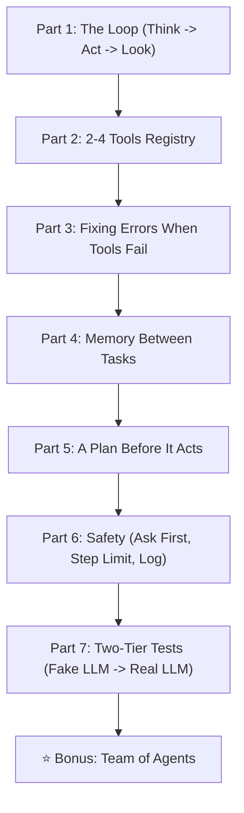

# Step-by-Step Execution Plan: Multimodal Vision Agent (Plain Python)

**Project:** Vision & Multimodal Workflow Automation Agent  
**Document:** `task.md`  
**Reference PRD:** `PRD Vision & Multimodal Workflow Automation.md`  
**Rule:** Built in **Plain Python 3** without agent frameworks (No LangChain, LlamaIndex, CrewAI, AutoGen).  
**Build Strategy:** Part-by-part, one component at a time, each accompanied by an explanation for the demo.

---

## 1. Build Order & Component Roadmap

We build the agent in strict sequential order from Part 1 through Part 7, followed by the Bonus (Part 8):



---

## 2. Step-by-Step Execution Checklist

---

### 1️⃣ Part 1: The Core Loop (Think → Act → Look) `[L1, L3]`
*Build file:* `agent/loop.py`  
*Concept:* The heart of an autonomous agent is a simple ReAct `while` loop that alternates between reasoning, tool execution, and observing feedback.

- [x] **Task 1.1:** Define data structures for `Thought`, `Action(tool_name, tool_args)`, `Observation`, and `AgentResponse`.
- [x] **Task 1.2:** Implement prompt formatter that gives the LLM the instruction template:
  - `Thought: <reasoning about what to do next>`
  - `Action: <tool_name>(<json_arguments>)`
  - `Observation: <result returned by environment>`
  - `Final Answer: <solution for user>`
- [x] **Task 1.3:** Build parser in pure Python (regex / string extraction) to cleanly parse the model's output into `Thought` and `Action`.
- [x] **Task 1.4:** Implement standard `while` loop in `run_agent(prompt)`:
  1. Call LLM with current prompt and history.
  2. Parse `Thought` and `Action` (or detect `Final Answer`).
  3. Execute tool and obtain `Observation`.
  4. Append observation to history and continue until `Final Answer`.
- [x] **Demo Explanation Ready:** Understand how string parsing extracts `Action` and how observations feed into the next prompt turn.

---

### 2️⃣ Part 2: 2–4 Tools, Clearly Described `[L2]`
*Build file:* `agent/tools.py`  
*Concept:* Tools are ordinary Python functions wrapped in a registry with clear descriptions, parameter schemas, and return dictionaries.

- [x] **Task 2.1:** Implement `@tool` decorator or `Tool` dataclass containing:
  - `name`: string identifier (e.g., `inspect_visual_document`).
  - `description`: clear explanation of what the tool does and when to invoke it.
  - `func`: executable Python callable.
  - `parameters`: dictionary describing expected arguments and types.
- [x] **Task 2.2:** Build **Tool 1: `inspect_visual_document(file_path: str, query: str)`**
  - Inspects an image or document, returns visual layout, text summary, and detected elements.
- [x] **Task 2.3:** Build **Tool 2: `extract_structured_fields(file_path: str, fields: list[str])`**
  - Extracts targeted values into structured JSON with bounding box coordinates and confidence.
- [x] **Task 2.4:** Build **Tool 3: `validate_business_rules(extracted_data: dict, rules: list[str])`**
  - Evaluates arithmetic sums, date formatting, and master reference checks; returns pass/fail and violation lists.
- [x] **Task 2.5:** Build **Tool 4: `dispatch_action_or_notification(action_type: str, payload: dict)`**
  - Sends approved data to an external endpoint/log. (Marked as sensitive for Part 6).
- [x] **Task 2.6:** Implement `ToolRegistry` with `get_tool(name)` and `get_tool_descriptions()` to auto-generate the prompt system instructions.
- [x] **Demo Explanation Ready:** Understand how function signatures are converted to LLM instructions and dynamically dispatched by name.

---

### 3️⃣ Part 3: Fixing Errors When a Tool Fails (Self-Correction) `[L2]`
*Build file:* `agent/loop.py` & `agent/tools.py`  
*Concept:* An agent must never crash on tool errors. Exceptions become observations so the agent can reflect and retry.

- [x] **Task 3.1:** Wrap `ToolRegistry.execute()` in a `try...except Exception as e` block.
- [x] **Task 3.2:** Format errors as structured observations:
  ```json
  {"status": "error", "error_type": "ValueError", "message": "File 'invoice_99.png' not found."}
  ```
- [x] **Task 3.3:** Ensure error messages include actionable feedback (e.g., available files or schema format).
- [x] **Task 3.4:** Add test scenario where a tool fails on Step 1, the agent reads the error observation in Step 2, corrects its argument, and succeeds on Step 3.
- [x] **Demo Explanation Ready:** Explain how `try/except` transforms Python stack traces into model observations for self-healing.

---

### 4️⃣ Part 4: Memory Between Tasks `[L4]`
*Build file:* `agent/memory.py`  
*Concept:* Short-term memory lives in RAM during a task; long-term memory persists to disk (JSON) so the agent remembers facts and preferences across tasks.

- [x] **Task 4.1:** Build `TaskMemoryStore` backed by `memory_store.json`:
  - `save_task_summary(task_id, goal, result)`: Records previous completions.
  - `record_learned_fact(key, value)`: Saves vendor quirks, layout insights, or user preferences.
  - `retrieve_context(query)`: Finds relevant facts from past tasks to inject into new prompts.
- [x] **Task 4.2:** Integrate memory into `run_agent()`:
  - On startup: Read `memory_store.json` and append a `<MemoryContext>` section to the system prompt.
  - On task completion: Automatically summarize the task and save any new facts or corrections.
- [x] **Task 4.3:** Build a test where Task 1 teaches the agent: *"Vendor Stark Industries always puts the invoice date in DD/MM/YYYY format"*, and Task 2 uses that memory without being told again.
- [x] **Demo Explanation Ready:** Show how `memory_store.json` survives process restarts and alters subsequent prompt context.

---

### 5️⃣ Part 5: A Plan Before It Acts `[L5]`
*Build file:* `agent/planner.py`  
*Concept:* Complex multimodal tasks fail when agents act impulsively. The agent must create an explicit plan before invoking tools and track progress.

- [x] **Task 5.1:** Add a **Planning Phase** before the ReAct loop starts:
  - Prompt the model to produce a numbered execution plan with status markers: `[TODO]`, `[IN_PROGRESS]`, `[COMPLETED]`.
- [x] **Task 5.2:** Implement `ExecutionPlan` class:
  - Tracks steps, current active step, and completed steps.
  - Injects the current plan state into each `Think` turn.
- [x] **Task 5.3:** Allow dynamic plan adjustment: if an error occurs in Part 3, the agent can emit `Plan Update: ...` to revise its steps.
- [x] **Demo Explanation Ready:** Explain the difference between prompt-level planning and action-level execution, showing the plan update after each tool call.

---

### 6️⃣ Part 6: Safety (Ask First, Step Limit, Audit Log) `[L7]`
*Build file:* `agent/safety.py`  
*Concept:* Safety guardrails prevent infinite loops, unauthorized actions, and provide an immutable audit trail.

- [x] **Task 6.1: Step Limit Guardrail**
  - Implement loop counter (`step_count`).
  - If `step_count >= max_steps` (default `10`), break the loop and return:
    `"Agent stopped: maximum step limit reached without completion."`
- [x] **Task 6.2: Human-in-the-Loop Confirmation ("Asks You First")**
  - Tag sensitive tools (`sensitive=True`), such as `dispatch_action_or_notification`.
  - When the agent selects a sensitive action, halt execution and prompt the human:
    ```text
    ⚠️ [SAFETY GATE] Action requires confirmation:
       Tool: dispatch_action_or_notification
       Payload: {'action_type': 'post_erp', 'amount': 1450.0}
       Approve execution? (y/n): 
    ```
  - When approved (`y`), authorize execution and record confirmation.
- [x] **Task 6.3: Audit Logger**
  - Append every thought, plan, action, argument, human decision, and observation with timestamps to `agent_audit.log`.
- [x] **Demo Explanation Ready:** Demonstrate the safety prompt intercepting a real write action for human sign-off, and demonstrate the step limiter killing a runaway loop.

---

### 7️⃣ Part 7: Two-Tier Testing Suite `[L8]`
*Build files:* `tests/test_fake_llm.py` & `tests/test_real_llm.py`  
*Concept:* First test deterministically without spending API credits or relying on network; then run end-to-end against real LLMs.

- [x] **Task 7.1: Tier 1 - Fake LLM Test Suite (Offline & Deterministic)**
  - Implement `FakeLLM` class that returns canned responses matching the expected format.
  - Test 1: Full Think → Act → Look cycle to completion.
  - Test 2: Tool failure & successful self-healing retry.
  - Test 3: Plan generation and step-by-step progress update.
  - Test 4: Safety gate prompts for approval on sensitive tool.
  - Test 5: Step limit stops infinite loop at exact limit.
  - Test 6: Memory persistence across two sequential tasks.
  - All Tier 1 tests run with `pytest tests/test_fake_llm.py` with zero API keys.
- [x] **Task 7.2: Tier 2 - Real LLM Integration Suite**
  - Connect to live Gemini / OpenAI API using native Python HTTP (`urllib` or `requests`).
  - Run end-to-end on a sample invoice / receipt image.
  - Verify live visual extraction, rule validation, and safety sign-off.
- [x] **Demo Explanation Ready:** Show `pytest` passing all Fake LLM tests in under 1 second, explaining why deterministic tests are essential for agent evaluation.

---

### ⭐ Bonus (Part 8): Team of Agents `[L6]`
*Build file:* `agent/team.py`  
*Concept:* Separate complex goals across specialized, collaborating agents instead of one monolithic prompt.

- [x] **Task 8.1:** Define specialized agents:
  1. **Orchestrator Agent:** Receives the goal, plans the breakdown, and assigns work.
  2. **Vision Analyst Agent:** Equipped with `inspect_visual_document` and `extract_structured_fields`.
  3. **Compliance Auditor Agent:** Equipped with `validate_business_rules` and audit checks.
- [x] **Task 8.2:** Implement agent-to-agent communication via simple structured message passing:
  `Orchestrator -> Vision Analyst -> Auditor -> Orchestrator`.
- [x] **Task 8.3:** Build end-to-end multi-agent run for an invoice review workflow.
- [x] **Demo Explanation Ready:** Explain how agent delegation reduces context window pollution and improves extraction accuracy.

---

## 3. Demo Preparation Guide (How to Explain Each Part)

When demoing the project, follow this exact script to explain the system:

| Part | What to Show | Key Explanation to Give |
|---|---|---|
| **1. The Loop** | `loop.py` execution trace in terminal | *"Here is the pure Python while loop. Notice it says 'Thought:', selects an 'Action:', and receives the 'Observation:' before deciding the next step."* |
| **2. Tools** | `tools.py` function definitions | *"We have 4 distinct Python functions. The agent sees their docstrings and parameters in its system prompt and calls them via Python dictionary dispatch."* |
| **3. Error Handling** | Intentional wrong file path | *"Watch what happens when a tool throws FileNotFoundError. The Python try/except catches it and turns it into an Observation. The agent reads it and self-corrects."* |
| **4. Memory** | `memory_store.json` before and after | *"In Task 1, the agent learned a vendor preference. Notice how in Task 2, it reads memory_store.json and applies that rule without being asked."* |
| **5. Planning** | Initial Plan output | *"Before running any tools, the planner outputs a numbered plan with [TODO] tags, marking each completed as it moves through the loop."* |
| **6. Safety** | Terminal confirmation prompt | *"Here is our safety gate: before dispatching external data, it halts and asks 'Approve execution? (y/n)'. It also enforces a hard limit of 10 steps."* |
| **7. Tests** | `pytest tests/test_fake_llm.py` | *"Our Tier 1 test suite uses a FakeLLM. It tests the entire loop, error recovery, and safety gates deterministically in milliseconds without API keys."* |
| **⭐ Bonus Team** | Multi-agent log output | *"In this bonus flow, the Orchestrator delegates image inspection to the Vision Specialist and verification to the Compliance Auditor."* |
| **🌐 Web Dashboard** | `app.py` via `.\run.bat web` | *"Here is our interactive Streamlit Web Studio: it allows anyone to run all 8 parts, inspect bounding boxes, authorize actions, and view the audit log in a browser."* |
| **📁 Multi-Format Uploads** | `app.py` + `uploads/` | *"Users can upload their own documents across PNG, JPG, WEBP, PDF, CSV, JSON, and TXT formats with live format-specific previews and dynamic tool execution."* |
